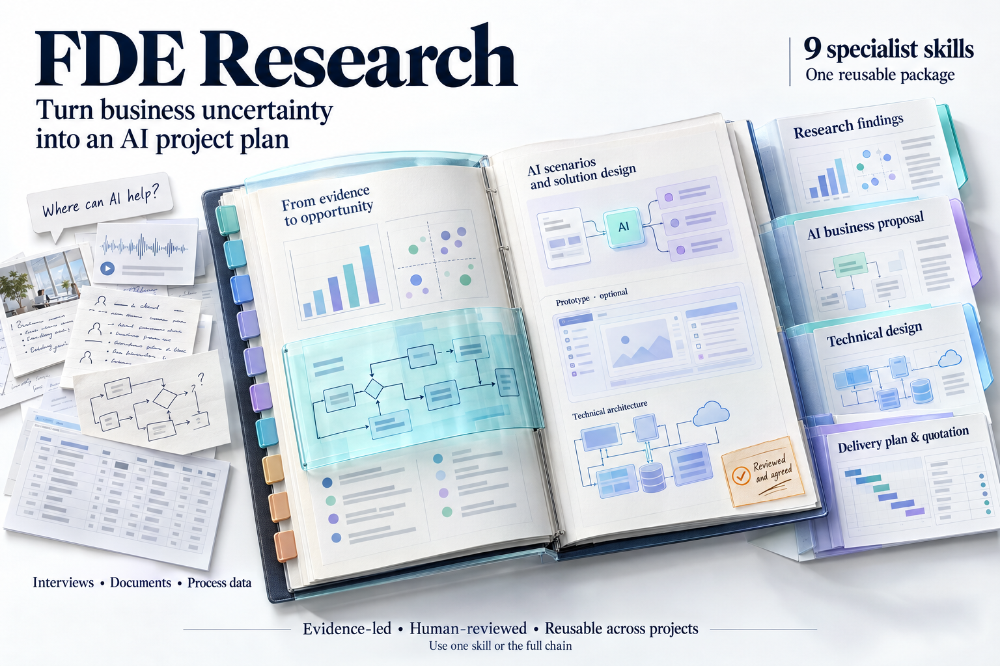
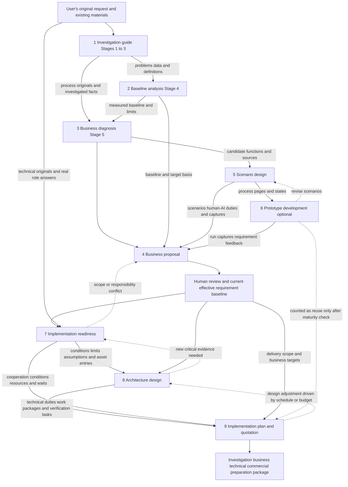

# FDE Enterprise AI Pre-Implementation Research and Solution Skill Package



**Publication preparation 2.3.0 · 2026-10-09.** This repository installs, runs, tests, and releases independently; no Chinese edition is required. **Publicly visible, all rights reserved; no open-source license is granted.** Usage instructions are for authorized users; see [LICENSE](LICENSE) and [provenance](NOTICE.md).

Start with [cross-platform installation](docs/github-installation.md); maintainers use [testing and release](docs/releasing.md). Release archives contain only skill resources. The repository also contains CI and this edition's historical validation evidence. Use the installer to keep `.git` and evidence out of agent skill directories.


Nine agent skills that can be used independently or collaborate through handed-off materials. They turn a business request into traceable investigation, requirement scenarios, an optional prototype, a business proposal, implementation conditions, a technical architecture, and an implementation plan with quotation. They suit different enterprises and projects and contain no built-in facts, authorizations, or default benefits for any particular customer.

**This is a preparation toolkit for the period before project implementation.** Used end to end, it yields business, technical, and commercial review materials; if you choose to implement the prototype, you also get a locally runnable prototype. Production development, real system integration, pilot launch, formal approval, and verification of post-launch benefits are still accomplished by actual engineering and business work.

**English edition 2.3.0 · updated 2026-10-09.** The nine professional skills are kept, and a unified routing entry `fde-research` is added, so the package contains 10 SKILL.md files. The entry selects and resumes work; it is not a tenth professional stage.

For cross-stage work an agent only needs the [workflow and handoff map](docs/workflow-map.md) and the current child SKILL; this page keeps the full user guide and relationship diagrams. Installation/version migration, shared copies, and runtime checks are in the [maintenance notes](docs/maintenance.md).

## Where to start reading

- Grouped installation, unified invocation, or selecting only one skill: [unified entry guide](docs/unified-entry.md); the agent entry is the root [SKILL.md](SKILL.md).
- First use: read "Quick start" and "How the skills connect" on this page, then the README of the relevant skill.
- You only have one vague sentence: see section 1.1, "Starting an NGS efficiency investigation from one sentence", which includes the launch prompt, first-round questions, and expected outputs.
- Unsure where files go: chapter 6 covers the customer project directory and chapter 10 the skill package directory; the [file-by-file guide](docs/package-files.md) can be searched by file name.
- Configuring an agent for the first time: section 11.0 covers grouped installation with the unified entry; sections 11.2–11.5 keep the optional way of registering the nine skills separately.
- Handing work to an agent: give the skill root, the project directory, the actual materials, and this round's goal, and use the launch prompt on this page.
- Cross-stage handoff or a new session: [handoff and version contract](docs/handoff-contract.md).
- Codex / Claude Code / other agents: [environment and installation](docs/runtime-and-installation.md).
- Complete ticket and NGS chatbot examples: [usage examples](docs/examples.md).
- Labels, simulations, and example parameters: [portability and labeling](docs/portability-and-branding.md).
- Version changes: [changelog](CHANGELOG.md).
- Checks actually performed for this version and what remains unverified: [validation record](docs/validation.md).

## 1. Quick start

**One sentence of need is enough to start an investigation, but one sentence alone cannot produce credible complete outputs.** Later work needs real interviews, originals, data, business decisions, and technical conditions; materials already provided are not requested again.

1. Save the complete skill package where the agent can read it. You can keep the current directory and tell the agent to read the root `SKILL.md` to choose a stage, or read a specific child skill's `SKILL.md`, or install according to the host's conventions. Do not copy only the nine SKILL.md files and leave the resources behind.
2. Give the real project its own directory. The skill package stores only methods; project materials and outputs are written to the project directory.
3. State this round's goal, for example "investigate first", "write the business proposal", "implement the prototype", or "produce a quotation from the existing technical solution". Choose the entry by goal; you do not have to run all nine every time.
4. The agent first identifies existing materials, effective versions, and gaps, maintains the project artifact index, and then reads the SKILL.md for the current step.
5. Handoffs advance by outputs and evidence status; neither a fixed number of rounds nor one call of each of the nine skills means completion.

Hosts that support `$skill-name` can use skill-invocation syntax; otherwise say "read the SKILL.md at the actual path and follow it". The package does not require a particular model, course, or enterprise account.

### 1.1 Teaching example: starting an NGS efficiency investigation from one sentence

A user may bring only one vague request:

> I want to use AI to improve how efficiently our department uses and analyzes NGS.

There is no need to write a complete requirements document first, nor to decide in advance to build a chatbot. The task here is to find out which roles and which steps are inefficient, and only then judge the direction of improvement. What follows is a usage example; the later questions, answers, and output planning are a teaching demonstration, not a record of a real customer investigation.

**How to begin.** In an agent session for the customer project you can simply describe the request above. To use this package explicitly, send the following in Claude Code:

```text
/fde-research I want to use AI to improve how efficiently our department uses
and analyzes NGS, but I have not worked out how yet. Please guide me step by step:
first clarify the current state, problems, and improvement opportunities, and
finally produce an investigation and diagnosis report. This round stops at
investigation and diagnosis; do not implement a prototype, design architecture,
or quote. Ask a few key questions each round, reuse materials I have already
provided, and organize actual files as we go. Where data is missing, record it
as to be verified; do not invent baselines or benefits.
```

"One sentence is enough to start" means the business input need not be complete. Project files still need somewhere to live: if you are already working in the customer project directory it is reused; if none has been specified, add an actual writable project directory. Other agents can read this package's root SKILL first and then receive the same task; whether natural-language auto-matching triggers it depends on the current host.

**How the first round guides the user.** The agent can start with the three questions below and adjust later investigation according to the answers, instead of asking for a questionnaire to be filled in all at once:

1. Whose work do you mainly want to improve: lab scientists, bioinformatics analysts, or the people coordinating requests?
2. What was the most recent analysis request that felt "inefficient"? Please walk through it from when the request was raised until usable results arrived.
3. What troubles you most right now: preparing inputs, repeated back-and-forth, waiting for runs, finding results, or understanding results? It is fine if you cannot say yet.

After the answers arrive, first save the known request, investigation scope, and items still needed; then follow up and gather evidence along a concrete task. Anything not answered stays unknown and is not filled in as fact on the user's behalf.

**How work proceeds next.** This example is carried mainly by 1 investigation guide, 2 baseline analysis, and 3 business diagnosis working together; there is no need to run all nine skills first.

|Progress|How the skills guide the user|Outputs that accumulate|
|---|---|---|
|Clarify the request and scope (1)|Confirm who has the problem, the start and end of the analysis task, and what should improve|Request record, investigation actions, project artifact index|
|Reconstruct the real process (1/3)|Trace preparation, submission, follow-up questions, execution, tracking, and delivery around one real task|Current-state process, role division, problem record|
|Collect usable evidence (1/3)|Read process notes, workflow catalogs, sample sheets, and task and failure records as needed|Business asset inventory, field meanings, evidence and gaps|
|Quantify the problems (2)|Once actual records exist, separate manual effort, communication rework, queue waiting, and compute time|Metric definitions, actual baseline, calculation and recomputation records|
|Diagnose and recommend (3)|Analyze causes and compare how process standards, existing-system improvements, and AI assistance apply|Investigation and diagnosis report, improvement opportunities, priorities, and conditions for them to hold|

When materials are insufficient, an evidence-based interim diagnosis and a collection plan can be delivered first; unmeasured metrics stay "not measured", and estimates or simulated data must not be written up as a current-state baseline. Each round ends by updating the files formed so far, the key gaps, and the next step; a new session resumes from the project artifact index.

**What you can finally get.** When the actual investigation materials support this round's conclusions, the deliverables are the Business Diagnosis and AI Opportunity Assessment Report, the current-state process and role division, the business asset and evidence index, recomputable baseline materials, and recommended opportunities with items still to verify. If data is still insufficient, the report marks conditional conclusions and attaches the unmeasured metrics and a follow-up collection list.

After the investigation, if the user goes on to ask for an implementation plan, continue with 5 scenario design, 6 prototype as needed, 4 business proposal, and then 7 readiness review, 8 architecture, and 9 quotation. Whether AI can shorten actual analysis compute time or integrate with existing workflows needs separate evidence; it cannot be promised directly from "we want to be more efficient".

More detailed example dialogue, how files accumulate, and how to judge when to stop are in the [complete one-sentence example](docs/examples.md).

## 2. Overview of the nine skills

The numbers are for explanation only and match the first four of the earlier version; they are not an execution order.

|Number and skill|Question it answers|Key inputs|Core outputs|Standalone use|
|---|---|---|---|---|
|1 [Investigation guide](fde-discovery-guide/README.md)|How is the work done now, and what evidence is still missing?|Original request, existing materials, actual interviews and evidence collection|Stages 1–5, process, asset inventory, problems and actions; calls 2/3 for the specialized stages|Can start from one request sentence; full Stage 4/5 needs sibling 2/3|
|2 [Baseline analysis](fde-baseline-analysis/README.md)|How big is the problem, and how are the numbers recomputed?|Problems, actual data, field meanings, metric definitions|Metric cards, scripts, run records, results and charts|Yes; needs real measurement material or a valid existing baseline|
|3 [Business diagnosis](fde-business-diagnosis/README.md)|What are the causes, and which improvements are worth doing?|Facts, process, assets, baseline, and limits|Seven-chapter diagnosis report, opportunity recommendations, complete asset package|Yes; can organize the necessary investigation itself|
|4 [Business proposal](write-business-ai-proposal/README.md)|What changes, how will work be done, and how do people and AI divide it?|Diagnosis, functions, process, responsibilities, target estimates, conditions; scenarios/prototype if any|Complete source draft, formal Word, traceability, and review items|Yes; accepts equivalent material without first calling the first three|
|5 [Scenario design](fde-ai-scenario-design/README.md)|How does a role get from input to result?|Originals, current state, candidate functions, and role rules|Before/after comparison MD/HTML, partial simulated pages, browser captures|Yes; needs no final proposal or real interfaces|
|6 [Prototype development](fde-prototype-development/README.md)|Can several scenarios be operated continuously and handed over?|Business assets, scenarios or equivalent material, rules, and simulation scope|Development handoff package; source code, run evidence, and feedback only when implementation is explicitly requested|Yes; preparation and implementation are two different completion states|
|7 [Implementation readiness](fde-implementation-readiness/README.md)|Are data, interfaces, authority, and deployment conditions sufficient for design?|Effective business requirements, scenarios, samples, actual technical materials and answers|Readiness report, new asset index, final design handoff|Yes; accepts equivalent effective requirements and originals|
|8 [Architecture design](design-ai-project-architecture/README.md)|Which technology, and how are the system and development organized?|Effective requirements, implementation conditions, business originals, current technical evidence|Technical solution MD/Word, diagram sources and static diagrams, internal conditions; optional Archify enhancement|Yes; standard diagrams do not depend on Archify|
|9 [Implementation plan and quotation](plan-ai-project-delivery/README.md)|Who does it, how long, how much, and how is it accepted?|Business scope, implementation conditions, final technical solution, commercial conditions|Plan and quotation MD/Word, acceptance annex, internal calculation, external/internal assumptions|Yes; supports first estimates and inheriting an existing quotation|

4 is about **business requirements and ways of working**, 8 about **technical implementation design**, and 9 about **implementation organization and commercial arrangements**; the three documents answer different questions and do not replace one another.

## 3. How the skills connect

### Recommended complete preparation chain



Readers that cannot display Mermaid can follow this order:

```text
1 organize investigation → 2 measure current state → 3 diagnose and recommend
                                                        ↓
                          5 design scenarios → 6 prototype preparation/implementation (optional)
                                   └──────────────┘
                                          ↓
                                 4 write the business proposal
                                          ↓ effective requirement baseline
                                 7 review implementation conditions
                                          ↓ final handoff and originals index
                                 8 technical architecture design
                                          ↓ current technical solution version
                                 9 implementation plan and quotation
```

1 runs through the investigation, and 2/3 are its specialized work; execution need not be strictly sequential. 5/6 usually take place before or while 4 is being co-created, and their findings flow back. 7 can flag key risks early, but formal closure needs an effective requirement baseline. If the budget does not work, 9 proposes adjustments and 8/4 handle the technical or business scope; functions must not be silently cut inside the quotation.

### Entry points and trimming

|What you have now / what you want|Where to start|Boundary to keep|
|---|---|---|
|Only a vague request|1; enter 2/3 when needed|Metrics without data are marked not measured; no fake baseline|
|Facts exist but you do not know whether it is worth doing|3, adding 2 when quantification is insufficient|Compare the contributions of process, rules, existing systems, and AI|
|Candidate functions exist and you want to see the way of working|5, then 6 as needed|Page simulation does not prove interfaces or model performance|
|Only a prototype requirement handoff|6 preparation mode|Deliver handoff_ready; do not develop automatically|
|Implement a complete prototype|6 implementation mode|Actually start it and verify scenario by scenario; real integration only as authorized|
|Diagnosis and process exist; a formal business proposal is needed|4, with 5/6 as needed|No forced re-investigation; real authority and targets still need a basis|
|Business requirements are clear and a project is being prepared|7 → 8 → 9|Record enterprise facts and engineering assumptions separately|
|Architecture exists; only a quotation is needed|9|Business scope and implementation conditions are also needed, not just one diagram|
|Keep previous prices and periods and complete the report|9 inherited mode|No automatic re-estimation; keep the source of the original values|

## 4. What each handoff actually passes

### 4.1 Handoff diagram for the nine skills

Solid lines show the usual material flow; dashed lines show material added when the prototype step is chosen. **Arrows show what is passed, not that the previous skill must have been called.** Existing equivalent outputs can be used directly as input; when 1 completes all investigation stages it needs sibling 2/3, see chapter 5.

```mermaid
flowchart LR
    S1["1 Investigation guide"] -->|data and definition leads| S2["2 Baseline analysis"]
    S1 -->|facts process originals| S3["3 Business diagnosis"]
    S2 -->|measured baseline| S3
    S3 -->|opportunities and candidate functions| S5["5 Scenario design"]
    S5 -.->|scenarios pages states| S6["6 Prototype development"]
    S3 -->|diagnosis and recommendations| S4["4 Business proposal"]
    S2 -->|baseline and estimation basis| S4
    S5 -->|target process and human-AI duties| S4
    S6 -.->|handoff material or verified feedback| S4
    S4 -->|effective requirements and asset entries| S7["7 Implementation readiness"]
    S7 -->|conditions limits final handoff| S8["8 Architecture design"]
    S4 -->|functional scope and business rules| S8
    S8 -->|technical solution and work starting points| S9["9 Implementation plan and quotation"]
    S7 -->|resources cooperation and waiting conditions| S9
    S4 -->|delivery scope and acceptance targets| S9
```



Without Mermaid support, read it as `1→2→3→5→[6 optional]→4→7→8→9`, while keeping the cross-stage inputs `1→3, 2→4, 3→4, 5→4, 4→8, 4→9, 7→9`. The numbers are not a calling order; 4 usually closes the business proposal after 5/6 co-creation.

The key point: **4 gathers business evidence and requirement demonstrations, 8 receives both 4's business scope and 7's technical conditions, and 9 receives 4, 7, and 8.** 9 cannot quote from an architecture diagram alone. Every stage also goes back to original materials; the originals index travels with the handoff, and a report does not replace originals. The rework arrows are omitted from the diagram; feedback paths are in chapter 3.

### 4.2 Material list for each handoff

|Handoff|Materials passed|What the receiver does|When material is missing|
|---|---|---|---|
|1 → 2|Process, problems, asset inventory, field dictionary, readable actual data|Defines metrics and actually computes|Outputs metric/collection suggestions; unknowns are not filled with 0|
|1/2 → 3|Originals, process, calculations, and limits|Analyzes causes and improvement opportunities|Forms bounded preliminary judgments|
|3 → 5|Recommended directions, candidate functions, originals, and effective limits|Expands tasks, actions, states, duties, and exceptions|Marks open conditions; does not invent approvals|
|5 → 6|Complete scenarios, simulated pages, captures, sources, and rules|Unifies business objects, pages, and continuous states|Prepares the handoff first or implements unaffected parts|
|2/3/5/6 → 4|Baseline, diagnosis, target process, scenario images, prototype findings|Forms scope, targets, human-AI responsibilities, and the business proposal|Keeps a conditional draft when authority or enabling conditions are missing|
|4 → 7|Current effective requirements and status, scenarios, original asset entries|Locates evidence on systems, data, authority, and environment|Does not treat unconfirmed drafts as approved scope|
|4 → 8|Current effective business proposal, functional scope, human-AI rules, and acceptance targets|Uses it as the requirement baseline for technical design, together with 7's implementation conditions|Scope conflicts go back to 4 for clarification and are not silently rewritten by the technical solution|
|7 → 8|Final handoff, unified index, limits, estimates, and later verification|Selects technology and designs, rechecking load-bearing originals|Critical unknowns are not disguised as resolved; a conditional design can be delivered|
|4/7/8 → 9|Scope, implementation conditions, technical solution, work and verification starting points|Breaks down work packages, per-person schedules, costs, acceptance, and quotation|Non-critical gaps can be stated as explicit assumptions; if the core route is missing, deliver conditionally|

Material sources keep five labels: **user-provided, reused upstream input, upstream output, collaborative supplement, and generated now**. Originals registered by a skill are still user-sourced; an inventory is not the data itself. Detailed minimum fields are in the [handoff contract](docs/handoff-contract.md).

Always reuse function, scenario, and problem IDs, and do not write suggestions, teaching settings, approvals, implementation, and verification as one undifferentiated "done". Every key conclusion must be traceable to a file version, record, or actual answer.

## 5. Three kinds of dependency that must not be confused

**Skill-file dependency**: the full investigation guide's Stage 4/5 explicitly reads the sibling baseline and diagnosis skills. The others depend mainly on equivalent outputs and do not require upstream work to come from a specific skill. When one skill is copied on its own, keep its own references/assets/scripts; the root collaboration notes are an enhanced entry, and a single skill can still be used under its own contract.

**Business evidence dependency**: originals, field meanings, actual data, scope decisions, authority, interfaces, resources, and the like cannot be created out of nothing by an earlier report. Normal engineering estimates can be used to continue design with their basis stated; key business authorization cannot be replaced by an estimate.

**Runtime capability dependency**:

|Capability|Where it is used|When it is insufficient|
|---|---|---|
|File reading/parsing/writing|All|State actual coverage; do not claim something was read from its file name|
|Data calculation and charting|2|Without execution there are no measured results|
|HTML and browser captures|5, 6|Text/code can be delivered; captures and interaction acceptance are marked incomplete|
|Word generation, real rendering, and visual review|4, 8, 9|Record source draft, DOCX generation, contents update, and visual review separately|
|Current technical research|8, and necessary price checks in 9|Mark as not currently verified; do not call prices or capabilities the latest|
|Editable architecture diagrams and actual static rendering|8 standard path|Diagram source alone is not complete diagram delivery|
|Archify and its runtime|8 enhanced path|Keep the old contract; do not pass off ordinary diagrams as Archify|

9 keeps the Codex documents-specific path and also offers a general Python/LibreOffice path that does not depend on Codex. The model and estimation rules are shared, and so are the Word quality requirements. See the [quotation skill README](plan-ai-project-delivery/README.md). Supporting Claude Code and other agents means Codex tool names are not required; it does not mean the host can do without file, execution, rendering, and image-viewing capabilities.

## 6. Project directory and unified entry

### 6.1 What each of the three locations holds

**The skill package stores reusable methods; the project directory stores one project's materials and outputs; the "project unified entry" in this chapter is the project artifact index, which points to the currently effective files.** It differs from the root `SKILL.md` "skill invocation entry": the SKILL chooses what to do, while the project index says where the evidence is and how far the work has gone. The index itself is not an executable program.

The project paths below are teaching examples; replace them with locations you can actually write to. This document does not create a customer project for you.

|Location|Path in this example|Contents|When it changes|
|---|---|---|---|
|Skill package source directory|`D:/FDE-Tools/fde-research`|SKILLs, methods, general templates, helper scripts, overview|When maintaining or upgrading the package; read-only during normal customer work|
|Customer project root|`D:\FDE-Projects\ticket-efficiency`|This project's inputs, investigation records, calculations, proposals, diagrams, quotation, and so on|Every time project work is done|
|Project unified entry|`D:\FDE-Projects\ticket-efficiency\project-artifact-index.md`|Paths of currently effective versions, stage status, gaps, next steps|Whenever outputs are added, versions change, or work is handed over|

Native agent skill installation directories are covered separately in chapter 11; they are where skill copies are loaded from. Installing skills is not creating a customer project, nor starting an investigation. Two customers should have two project roots and must not share one project index.

### 6.2 How a project grows step by step

Keep an existing `business-analysis/00–04` structure; a project with an equivalent structure need not rebuild it. The tree below is the **recommended layout inside a customer project**, which differs from the skill package directory in chapter 10. Create folders stage by stage; you do not need every folder at the start.

```text
ticket-efficiency/                    one project, not the skills package
  project-artifact-index.md           current stage, effective versions, reading order, to-dos
  business-analysis/
    00-project-entry/                 original request, scope, and material entries
    01-investigation/                 1's interviews, stage records, and investigation actions
    02-diagnosis-package/             3's diagnosis and recommendations
      business-assets/                originals index, field dictionary, 2's baseline and run records
    03-solution-materials/
      scenario-design/v01/            5's MD/HTML/screens/images
      prototype-handoff/v01/          6's preparation materials, or a pointer to a separate prototype package
      other supplementary materials   function conditions, target process, responsibilities, estimates, etc.
    04-business-proposal/v01/         4's complete source draft, Word, and review record
  prototype/                          source, data, and run evidence in 6's implementation mode
  implementation-readiness/           7's round reports, asset entries, and final handoff
  technical-architecture/run-YYYYMMDD-NN/   8's report, diagrams, conditions, research, and verification
  delivery-plan-and-quotation/run-YYYYMMDD-NN/v001/
    client/                           9's external report, acceptance details, and assumptions
    internal/                         internal written basis
    model.json, results.json, etc.    internal calculation materials; not default external attachments
    qa/                               rendering, final-file hashes, and checks
```

`v01` and `v001` are per-stage versions, and `run-YYYYMMDD-NN` is one work batch; follow each skill's actual directory contract. Entries such as "other supplementary materials" describe content and are not file names to copy. Originals that cannot be moved are registered with their actual controlled location and access method and need not be copied into the project; an asset inventory only points the way and does not mean the material has been read or verified.

### 6.3 First use: create only the entry, then do this round's work

First open your customer project directory in the agent and make sure the skill package path is also readable. The first time you can simply send the following; there is no need to create the whole directory tree by hand:

```text
Please initialize and start the "ticket-efficiency" project.
Skill package: D:/FDE-Tools/fde-research
Project directory: D:\FDE-Projects\ticket-efficiency
This round covers only investigation preparation. The business request is to
shorten ticket handling time; no materials have been provided yet.

First read the skill package README and fde-discovery-guide/SKILL.md.
Following templates/project-artifact-index.md, create project-artifact-index.md
in the project directory, or update it if it exists.
Create only the project entry and investigation folders this round needs, and
write down the current request clearly.
List the processes, roles, data, and interview items to understand, and start Stage 1.
Write "to be provided" for missing materials and "not started" for stages not
executed; do not generate reports or fake data in advance.
Write outputs to the project directory; the skill package is read-only.
```

A reasonable first output is **the project index, the request record, investigation preparation, and a list of materials still needed**. Use 2 to compute only after actual data arrives; use 3 to diagnose once facts and a baseline exist; then choose 5/6/4 and so on by goal. A directory plan can be written early, but a plan does not count as outputs having been produced.

### 6.4 How the index lets the nine skills continue one another

Taking a future stage of the ticket project as an example, the table below only shows how to fill in entries and does not mean the package already contains these project files:

|Index item|Example entry|How the receiver uses it|
|---|---|---|
|Current business proposal|`business-analysis/04-business-proposal/v02/business-proposal.md`; generated, awaiting review|7/8 first confirm whether this version can serve as this round's requirement basis and do not treat it as approved automatically|
|Current baseline|`business-analysis/02-diagnosis-package/business-assets/baseline-analysis/calculation-run-record.md`; records data version and execution results|3/4 reuse the numbers and trace back to data, scripts, and definitions through the run record|
|Implementation readiness handoff|`implementation-readiness/round-01/implementation-conditions-and-design-handoff.md`; interface authority still to be verified|8 states the design conditions; 9 accounts for the corresponding cooperation, waiting, and verification work|
|Quotation not yet started|Actual output entry "none"; status "not started"|Do not treat a planned future path as an existing quotation file|

At the end of every skill, update: **actual output paths and versions, generation/verification/business-confirmation status, key gaps, and the suggested next step**. When switching sessions or agents, have it read the project index first, and then read originals and the current stage's SKILL according to the index. Do not paste full reports into the index, and do not use "most recent date" in place of an explicit choice of effective version.

To continue the project you can send:

```text
Please first read D:\FDE-Projects\ticket-efficiency\project-artifact-index.md,
and read the currently effective outputs and originals by following the index;
the skill package is still at the example path above.
Explain which stage we are in and which gaps affect the next step, then continue
the agreed work for this round.
Reuse existing materials, keep old versions and manual edits, and update the
index and handoff record when done.
```

Templates: [project artifact index](templates/project-artifact-index.md) and [stage handoff](templates/stage-handoff.md). They are blank structures for the agent to fill in inside the project. Reuse an existing equivalent index first; "phase one" in the technical review belongs to the technical stages and is not the investigation guide's Stage 1. When sharing externally, choose files according to actual authorization; `internal` material and calculation workpapers are not distributed with the customer report by default.

## 7. Changes, completion, and human decisions

Trace the impact of a change along "originals/definitions → baseline/diagnosis → functions/scenarios/scope → implementation conditions → technical decisions → work/acceptance → schedule/cost". Update only the affected parts, and keep old versions, reasons for the change, and manual edits. Prototype findings can flow back to scenarios and the business proposal; changes in technical conditions can flow back to scope; quotation pressure can trigger a discussion of options without automatically changing confirmed requirements.

Delivery involves three independent judgments:

- **File status**: not started, in progress, partially delivered, generated.
- **Verification status**: not verified, partially verified, required checks completed, with real evidence attached.
- **Business status**: suggestion, awaiting human review, current effective baseline, approved, with the actual source attached; an agent's self-check does not replace approval.

A conditional solution can have a complete body; keeping critical unknowns does not have to stop all work. Conversely, a complete set of documents does not prove that enterprise authority has been granted or that benefits have been realized. Each skill's specific completion conditions are in its own README and SKILL.md.

## 8. What is finally delivered

When the full chain completes successfully within its actual scope, it forms six kinds of output:

1. Investigation and diagnosis package: facts, process, originals index, recomputable baseline, problem causes, and recommendations.
2. Requirement demonstration package: before/after scenarios, partial simulations, captures; plus a runnable prototype when 6's implementation mode is chosen.
3. Business proposal package: scope, human-AI responsibilities, targets and conditions, complete Word, and review items.
4. Implementation conditions package: real new evidence, limits, assumptions, later verification, and the final handoff.
5. Technical architecture package: current basis for technology choices, system and development design, editable diagram sources, static diagrams, Word; plus Archify interactive diagrams on the enhanced path.
6. Implementation and commercial package: work breakdown, staffing and schedule, acceptance, service quotation, customer-paid items, recurring costs, and a separately stored internal calculation basis.

The last report is the Implementation Plan and Quotation Report, but **the final delivery is not just that quotation file**. There should be one project index that traces business rationale, scope, evidence, technology, and cost. Development and launch, contract signing, procurement, and operating benefits are not completed automatically by this preparation package.

## 9. Launch prompt for an agent

```text
Please use the FDE nine-skill package to advance the current project.
Skill root: fill in the actual path.
Project root: fill in the actual path.
Original request: fill in the business goal.
Existing materials: list readable locations; mark missing ones as unknown.
This round's scope: fill in the actual scope among investigation, proposal,
prototype preparation/implementation, technical design, or quotation.

First read the root SKILL.md and choose this round's stage through the unified
entry; read the root README and the relevant child SKILL as needed, identify
effective inputs and gaps, and maintain the project artifact index.
When starting from a vague request, organize with the investigation guide,
compute with baseline analysis, and form recommendations with business diagnosis.
Once candidate functions exist, use scenario design to describe future work, and
choose prototype preparation or implementation according to this round's scope.
Use the business proposal to close scope, responsibilities, conditions, and
targets, recording real review and requirement status.
Once an effective requirement baseline exists, review implementation conditions
and automatically form the final handoff and asset entries; then do the technical
architecture, and finally generate the implementation plan and quotation from the
current scope and technical solution.
When the user specifies keeping an original quotation, use inherited mode and do
not re-estimate automatically.

Reuse provided materials and do not ask for them again; do not write simulations
and assumptions as enterprise facts or approvals.
Keep function, scenario, and problem IDs and sources; changes update only the
affected outputs.
Check the actual tools, choose standard/Archify diagrams and the Codex/generic
Word path, and record the contract used.
Write outputs to the project; the skill package is read-only. In the delivery,
state actual outputs, the verified scope, and remaining conditions.
```

## 10. How to read the files in the skills directory

This chapter is about **the reusable skill package itself**. Customer originals, filled-in forms, generated reports, pages, and run records live in the project directory of chapter 6 and are not written back into the templates here.

```text
skills/
  SKILL.md                             fde-research unified entry: full chain / single skill / continue
  README.md                            master README: relationships among the nine skills and the overall entry
  CHANGELOG.md                         version changes
  docs/                                package-wide handoff, installation, examples, labeling, and validation notes
  templates/                           index and handoff templates shared across skills
  scripts/                             package-wide maintenance checks
  fde-discovery-guide/                 1 investigation guide
  fde-baseline-analysis/               2 baseline analysis
  fde-business-diagnosis/              3 business diagnosis
  write-business-ai-proposal/          4 business proposal
  fde-ai-scenario-design/              5 scenario design
  fde-prototype-development/           6 prototype development
  fde-implementation-readiness/        7 implementation readiness
  design-ai-project-architecture/      8 architecture design
  plan-ai-project-delivery/            9 implementation plan and quotation
```

### 10.1 Shared files in the root directory

|File|Purpose and when to use it|
|---|---|
|[SKILL.md](SKILL.md)|Agent unified entry: reads and executes the relevant child SKILL in the package according to this round's scope|
|[README.md](README.md)|For people and agents to understand the full chain, choose an entry, and arrange handoffs first|
|[CHANGELOG.md](CHANGELOG.md)|To judge differences between old and new versions when upgrading|
|[docs/handoff-contract.md](docs/handoff-contract.md)|Shared contract for passing outputs, originals, IDs, status, and effective versions across skills|
|[docs/unified-entry.md](docs/unified-entry.md)|Grouped installation location, entry name, single-skill selection, and how it differs from separate commands|
|[docs/runtime-and-installation.md](docs/runtime-and-installation.md)|Post-installation checks, project-level configuration, changing environments, dependency discovery, and common problems|
|[docs/package-files.md](docs/package-files.md)|File-by-file purpose for the nine skills; covers every file in the package and is suited to lookup|
|[docs/examples.md](docs/examples.md)|Chain examples for ticket and NGS scenarios; for understanding the method, not customer facts|
|[docs/portability-and-branding.md](docs/portability-and-branding.md)|Boundaries for portability, organization labels, simulation notices, and example parameters|
|[docs/validation.md](docs/validation.md)|Which checks were actually performed and which runtime environments remain unverified|
|[templates/project-artifact-index.md](templates/project-artifact-index.md)|When a new project sets up its unified entry, copy the structure into the project and fill it in|
|[templates/stage-handoff.md](templates/stage-handoff.md)|When switching skills, people, or sessions, record outputs, basis, scope, and open items|
|[scripts/check_package.py](scripts/check_package.py)|Maintainer check of the 1 unified entry, 9 child entries, document links, syntax, and caches inside the package; it does not execute nine-skill projects|

### 10.2 Division of files inside each skill

|Name|Who reads/uses it and when|Does every skill need it?|
|---|---|---|
|`README.md`|People read it first: purpose, inputs and outputs, usage, dependencies, completion conditions|All nine in this package have one|
|`SKILL.md`|The agent reads it when executing the skill: trigger scope, steps, constraints, and resource entries|Required; it is the skill entry|
|`references/`|The agent reads detailed methods, data contracts, documents, and verification rules as SKILL directs|As needed; absence does not mean a missing file|
|`assets/`, `assets/templates/`|Templates, JSON examples, report skeletons, or page bases; copied or referenced and then used inside the project|As needed; these are not existing outputs of a customer project|
|`scripts/`|Helper programs the agent uses when the environment supports them; input and output paths point to the project|As needed; a skill can be complete without scripts|
|`agents/openai.yaml`|Hosts that support this metadata use it for display name, description, and prompt|Optional; Claude Code and others can ignore it without affecting the SKILL body|

### 10.3 What is special in each of the nine directories

|Number|Contents besides README/SKILL|Actual use|
|---|---|---|
|1|Stage 1–5, overview, asset, field, metric, run, and revision templates in `assets/templates/`|Organize the investigation; Stage 4/5 continue into 2/3. Templates are filled in inside the project|
|2|Metric card, calculation run record, Stage 4 template|Leave a recomputable basis for the baseline; the same-named templates in 1 serve each skill's standalone use|
|3|Investigation record and seven-chapter report templates, diagnosis and asset delivery notes, optional interface metadata|Turn facts and numbers into problem causes, recommendations, and an asset package|
|4|Three references: input evidence, proposal structure, Word format and checks|Write the business proposal; no bundled scripts, uses the document capabilities the host actually has|
|5|Page template, three scenario references, page build/capture/report rendering scripts, label tests|Produce before/after scenarios and actual browser captures; page generation and capture are different steps|
|6|Four references: product organization, handoff, state simulation, verification|First form a development-ready handoff; generate the prototype inside the project when the user asks for implementation|
|7|Three templates for the review, single-item records, and final handoff; four review references|Establish real conditions and hand originals and open items to 8/9|
|8|Conditions/report templates, selection/system/diagram/Word/run rules, report and delivery check scripts|Form the technical solution; standard diagrams and the Archify enhanced contract are checked separately|
|9|Estimation model and examples, report/assumption templates, general and Codex workflows, estimation/inheritance/Word/delivery scripts|Form the plan and quotation; keep the internal calculation basis; both Word runtime paths share one business model|

To check what a script actually produces, such as `build_screens.py`, `estimate.py`, or `finalize_word.py`, open the [complete file-by-file guide](docs/package-files.md). There is no need to read every reference file at startup.

## 11. How to configure Codex or Claude Code and start

### 11.0 Recommended: install the whole package by domain and call the unified entry

If you want to manage FDE separately from skills for other domains, **copy the complete `skills` source package as a folder named fde-research** into the Claude Code personal skills directory. The entry is then at:

```text
~/.claude/skills/fde-research/SKILL.md
```

`~/.claude/skills/` is the container for all skills; `fde-research/` is the installed package, and the entry must not be placed at the container root. The package keeps the README, shared materials, and nine sibling child skills; skills for other domains sit alongside `fde-research`. The entry's `name` is `fde-research`, so use `/fde-research`.

```text
/fde-research complete preparation chain. The project directory is D:/FDE-Projects/ticket-efficiency; this round does investigation preparation first.
/fde-research only baseline analysis. Use the data already provided in the current project and complete only this round's quantification.
/fde-research only 9. Keep the old quotation I specify and use inherited mode to complete the implementation plan and report.
/fde-research continue. Read the current project artifact index first, then continue the agreed scope.
```

Each line is one example message. You can select by number, English title, or full skill name; "only 2" and "only fde-baseline-analysis" both run only baseline analysis. Child skill files are located relative to the actual location of the entry and do not depend on the example source location or a fixed user name.

**A single child skill can be run through the unified entry, but adding the entry does not automatically register nine separate slash commands.** Use commands such as `/fde-baseline-analysis` directly only when the host recognizes the child skills separately. A complete directory-copy example, the basis for command names, and more usage are in the [unified entry guide](docs/unified-entry.md).

Codex and other agents can also read this root SKILL and apply the same routing; environments with native discovery can use the `fde-research` entry they actually discover. Automatic registration of nested child skills is not promised for unverified host versions. Sections 11.2–11.5 keep the **optional way of registering the nine skills separately**; you need not use it alongside the grouped installation.

### 11.1 Choose one way first

|Way|When it fits|What you do|
|---|---|---|
|Grouped package with unified entry (recommended)|Managing by domain and choosing stages through one entry|Put the complete directory at skills/fde-research and read the root SKILL; see 11.0|
|A: read the skill package directly|Trying it once, or another agent that can read local files|Give the source package and project paths and read the root SKILL to choose a stage, or read a child SKILL directly; no installation|
|B: register the nine skills separately|You want nine separate native commands|Copy the nine skill folders completely into the corresponding skills directory, then start the agent in the customer project|

Grouped installation with the unified entry is recommended for managing by domain; A suits occasional use. Sections 11.2–11.5 below demonstrate B, which is needed only if you want the nine skills registered separately. Every way requires the agent to be able to read the actual path; the source package on the example source location is not registered in a menu just because it is mentioned.

### 11.2 Optional flat installation locations: personal reuse or project sharing

|Agent|Personal level: reuse across projects|Project level: under the customer project/repository root|
|---|---|---|
|Codex|`~/.agents/skills/<skill-name>/SKILL.md`|`.agents/skills/<skill-name>/SKILL.md`|
|Claude Code|`~/.claude/skills/<skill-name>/SKILL.md`|`.claude/skills/<skill-name>/SKILL.md`|

`~` is the home directory of the user running the agent. On native Windows it usually corresponds to `C:\Users\<your user name>`. Use the home directory of whichever system you install on. Choose only one load location to reduce version confusion from same-named copies. These locations follow the [Codex official skills documentation](https://learn.chatgpt.com/docs/build-skills) and the [Claude Code official skills documentation](https://code.claude.com/docs/en/skills), checked on 2026-10-07.

### 11.3 Optional: PowerShell copy example for nine separate skills

The following is a **manually executed installation example**, not a prompt for the agent. By default it installs into the Codex personal directory; for Claude Code replace only the marked destination line. The script copies only this package's nine skills; if a same-named folder already exists it stops so you can compare versions first, without overwriting existing customizations.

```powershell
$ErrorActionPreference = 'Stop'
$fdeSkillSource = 'D:/FDE-Tools/fde-research'
$fdeSkillsDestination = Join-Path $env:USERPROFILE '.agents\skills'
# Claude Code personal level: replace the line above with the line below (remove the leading #)
# $fdeSkillsDestination = Join-Path $env:USERPROFILE '.claude\skills'
# For project level, set the destination to .agents\skills or .claude\skills under the actual project.

$fdeSkillNames = @(
    'fde-discovery-guide', 'fde-baseline-analysis', 'fde-business-diagnosis',
    'write-business-ai-proposal', 'fde-ai-scenario-design',
    'fde-prototype-development', 'fde-implementation-readiness',
    'design-ai-project-architecture', 'plan-ai-project-delivery'
)

# Check all nine completely before copying anything.
foreach ($fdeSkillName in $fdeSkillNames) {
    $fdeSourceFolder = Join-Path $fdeSkillSource $fdeSkillName
    $fdeTargetFolder = Join-Path $fdeSkillsDestination $fdeSkillName
    if (-not (Test-Path -LiteralPath (Join-Path $fdeSourceFolder 'SKILL.md') -PathType Leaf)) {
        throw "Missing skill entry: $fdeSourceFolder"
    }
    if (Test-Path -LiteralPath $fdeTargetFolder) {
        throw "A same-named target already exists; check and preserve the old version first: $fdeTargetFolder"
    }
}
New-Item -ItemType Directory -Path $fdeSkillsDestination -Force | Out-Null
foreach ($fdeSkillName in $fdeSkillNames) {
    Copy-Item -LiteralPath (Join-Path $fdeSkillSource $fdeSkillName) `
        -Destination (Join-Path $fdeSkillsDestination $fdeSkillName) -Recurse
}
Write-Output "Nine skills copied to: $fdeSkillsDestination"
```

After copying, the layout should be:

```text
%USERPROFILE%\.agents\skills             Codex example; for Claude use .claude\skills
  fde-discovery-guide\SKILL.md
  fde-discovery-guide\README.md
  fde-discovery-guide\assets\...
  fde-baseline-analysis\SKILL.md
  fde-business-diagnosis\SKILL.md
  ...complete folders of the other six sibling skills...
```

Do not copy only the nine `SKILL.md` files; bring the references, templates, and scripts in the same folders too. The root README, `docs/`, shared `templates/`, and root `scripts/` stay in the source package on the example source location as the full-chain guide; the launch prompt gives its location explicitly. After a split installation, a single skill README's "back to overview" link may not work; read it in the complete source package instead. This does not affect execution of the skill's internal resources.

**A copy is a version snapshot.** Later changes to the complete source package do not update installed copies. Before upgrading, compare and preserve customizations, then update the chosen installation location; projects in progress record which package version they use. Complete backups and migration packages should still keep the whole source package.

### 11.4 After registering nine skills separately: starting in Codex

In Codex, select or open the customer project directory, for example `D:\FDE-Projects\ticket-efficiency`. If you use the installed Codex CLI, you can also start `codex` in that directory. Confirm that `fde-discovery-guide` appears where skills can be selected; in the CLI/IDE use `/skills` or type `$` to choose a skill. How to select varies by interface; you can also simply say "use fde-discovery-guide". See the [Codex official documentation](https://learn.chatgpt.com/docs/build-skills) for invocation.

The following is message content for Codex; `$fde-discovery-guide` is not a PowerShell command:

```text
$fde-discovery-guide
Please first read D:/FDE-Tools/fde-research\README.md.
Current project: D:\FDE-Projects\ticket-efficiency.
Original request: shorten ticket handling time. Existing materials: none provided yet.
This round does only Stage 1 investigation preparation; create or update the
project artifact index and the investigation action list.
Execute fde-discovery-guide from this round's load location, and read 2/3 from
the sibling skill folders as needed;
if the source package and the installed copy differ in version, first state which
location is actually used.
Write outputs to the customer project; the skill package is read-only. Mark unknown
and unexecuted items truthfully.
```

### 11.5 After registering nine skills separately: starting in Claude Code

After the nine skills are copied flat into `.claude/skills` as above, start the installed `claude` in the actual project directory, or open the project in the Claude Code interface. Invoke with `/fde-discovery-guide` in the conversation; it is a Claude Code conversation command, not a script run in PowerShell. See the [Claude Code official documentation](https://code.claude.com/docs/en/skills).

```text
/fde-discovery-guide Please read D:/FDE-Tools/fde-research\README.md. The project is D:\FDE-Projects\ticket-efficiency, the goal is to shorten ticket handling time, and no materials have been provided yet. This round does only Stage 1 investigation preparation; create or update the project artifact index and the investigation action list. Execute the current installed copy and read 2/3 from sibling folders; write outputs to the project directory; the skill package is read-only.
```

Later you can call `/fde-ai-scenario-design`, `/write-business-ai-proposal`, and others by stage, with inputs taken from the project artifact index. Other agents without a skill menu use "read the SKILL.md at the actual path and execute it".

### 11.6 How to confirm it is ready

Have the agent report **the SKILL path it actually read, the current project path, this round's inputs, and the expected outputs**. Complete a small task such as investigation preparation first, check that the project really contains the index and action list, and then move on to later stages. A visible skill only shows it is loaded; it does not mean data calculation, browser, or Word tools are all available.

If discovery fails, check the file hierarchy, launch directory, running user, and same-named copies; reopen the session and check again, or read the files directly using A first. If the agent runs in WSL, a container, or a remote environment, the example source location path may not be readable: WSL commonly uses `/mnt/g/...`, and remote environments need the materials placed somewhere readable there, replacing all example paths.

The quotation stage keeps the Codex-specific document chain; Claude Code and other agents choose the generic Word path and run it only after discovering the actual Python/LibreOffice and other capabilities. Changing agents alone does not justify claiming that rendering is complete. Project-level installation targets, optional project conventions, migration/upgrades, and troubleshooting are in [environment and installation](docs/runtime-and-installation.md). This version only provides configuration notes and does not install anything into your personal agent directories automatically.

## 12. Maintenance and checks

Maintainers can run `python -B -X utf8 scripts/check_package.py` at the root of the complete package to check the unified entry, nine child entries, READMEs, JSON syntax, Python syntax, in-package Markdown links, and directory cleanliness. It does not run customer projects, certify professional judgment, or install dependencies.

Regression check for the quotation calculation: `python -B -X utf8 plan-ai-project-delivery/scripts/test_estimate.py`. Environment/document adaptation checks are the test files in the corresponding scripts folders. Use `-B` or set `PYTHONDONTWRITEBYTECODE=1` to avoid writing caches into the skill package. Passing tests does not replace the actual project model, the final Word, or business verification. Do not put caches produced by check tools, customer samples, keys, or run outputs into a skill release package.
