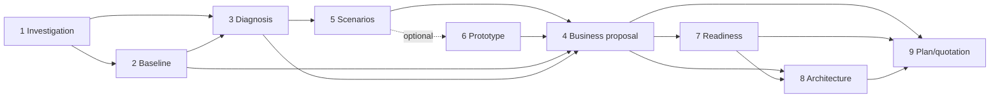

# Workflow and handoff quick reference

Read this concise map for cross-stage work. IDs identify skills; positions show a typical preparation sequence that can stop at the requested scope or reuse equivalent inputs. Resolve ambiguous “step N” wording against the current plan rather than treating it automatically as a skill ID.

| Typical position | Skill ID and entry | Main input → output |
|---|---|---|
|1|[1 Investigation](../fde-discovery-guide/SKILL.md)|Goal, roles, materials → scope, current process, source index|
|2|[2 Baseline](../fde-baseline-analysis/SKILL.md)|Actual data, observations, definitions → actually computed baseline, charts, and recalculation record|
|3|[3 Diagnosis](../fde-business-diagnosis/SKILL.md)|Process, assets, baseline/limits → diagnosis and candidate opportunities|
|4|[5 Scenarios](../fde-ai-scenario-design/SKILL.md)|Candidates, originals, responsibilities → before/after scenarios, pages, capture status|
|5 optional|[6 Prototype](../fde-prototype-development/SKILL.md)|Scenarios/materials → handoff_ready or authorized implementation/feedback|
|6|[4 Business proposal](../write-business-ai-proposal/SKILL.md)|2/3/5 and optional 6 → effective scope, future work, human/system responsibilities|
|7|[7 Readiness](../fde-implementation-readiness/SKILL.md)|4 and originals → six-dimension conditions and final design handoff|
|8|[8 Architecture](../design-ai-project-architecture/SKILL.md)|4/7 and relevant code → technical design, editable sources and rendered diagrams|
|9|[9 Plan/quotation](../plan-ai-project-delivery/SKILL.md)|4/7/8 and commercial instructions → schedule, acceptance, quotation, internal basis|

Skill 1 uses 2/3 for its full Stage 4/5 investigation rather than generating duplicate, conflicting conclusions. Handoffs carry actual artifact/source locations, effective versions, stable IDs, facts/assumptions/simulation, and separate generation, verification, and business-confirmation states. Feedback: 6 → 5/4; business scope conflicts in 7 → 4; new enterprise evidence needed by 8 → 7; time/budget conflicts in 9 → affected 4/7/8 decisions. Never silently reduce scope.

On recovery verify the index's entry/package version and read the current child SKILL. Standalone skills accept equivalent inputs; investigation-only work closes within 1–3 without automatically designing or quoting. See the [handoff contract](handoff-contract.md) for fields and the [master README](../README.md) for user instructions.
